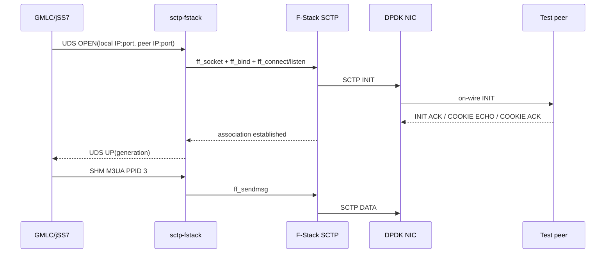

# Production F-Stack/DPDK SCTP gate

## Current truth

The native code has a real F-Stack lane: `ff_init`, `ff_socket`, `ff_bind`,
`ff_connect`, `ff_accept`, `ff_sendmsg`, and `ff_recvmsg`. UDS and SHM remain
Java-to-sidecar IPC only. The sidecar advertises `CAP_DPDK|CAP_FSTACK_SCTP` only
after F-Stack initialization returns and an SCTP socket probe succeeds.

The pinned v1.25 fork now compiles the complete FreeBSD SCTP endpoint, input,
output, PCB, timer, AUTH, ASCONF, sysctl, checksum, IPv4, and IPv6 source set.
It also carries three userspace/build adaptations: `kproc_create` maps
long-lived protocol workers to F-Stack-aware pthreads, `timingsafe_bcmp.c` is
linked for SCTP AUTH, and the library is position independent for the FFM
shared-library lane. The archive gate checks endpoint symbols; `alias_sctp.c`
alone can never satisfy it.

Source and DPDK linking are complete. Hardware/on-wire acceptance remains a
separate gate: this development host has no reserved hugepages or DPDK-bound
NIC, so `ff_init` correctly fails before the `ff_socket(SCTP)` readiness probe.

## Integrated FreeBSD source set

`libfstack.a` includes:

- Core: `sctp_asconf.c`, `sctp_auth.c`, `sctp_bsd_addr.c`,
  `sctp_cc_functions.c`, `sctp_crc32.c`, `sctp_indata.c`, `sctp_input.c`,
  `sctp_output.c`, `sctp_pcb.c`, `sctp_ss_functions.c`, `sctp_sysctl.c`,
  `sctp_timer.c`, `sctp_usrreq.c`, and `sctputil.c`.
- Support: `sctp_kdtrace.c`, `sctp_peeloff.c`, and IPv6
  `netinet6/sctp6_usrreq.c`.
- Dependencies: `libkern/timingsafe_bcmp.c` and `crypto/sha2/sha256c.c`.

`-DSCTP` enables the static IPv4/IPv6 protocol-switch entries already present
in `in_proto.c` and `in6_proto.c`. `sctp_module.c` and `sctp_syscalls.c` are
intentionally excluded: they are FreeBSD loadable-module and kernel syscall
registration glue, while F-Stack sockets enter through `ff_socket` and the
static protocol tables.



## Build gate

Materialize the exact pin, build DPDK/F-Stack, then configure this project:

```bash
git -C vendor/f-stack sparse-checkout set \
  adapter app doc docs dpdk example freebsd lib mk tests tools
export FF_PATH="$PWD/vendor/f-stack"
export PKG_CONFIG_PATH="$FF_PATH/dpdk/install/lib/pkgconfig"
make -C "$FF_PATH/lib"
./scripts/validate-fstack-sctp.sh \
  "$FF_PATH" "$FF_PATH/lib/libfstack.a"

cmake -S . -B build-dpdk \
  -DSCTP_HAVE_LKSCTP=OFF \
  -DSCTP_HAVE_FSTACK_DPDK=ON \
  -DFSTACK_ROOT="$PWD/vendor/f-stack"
cmake --build build-dpdk
ctest --test-dir build-dpdk --output-on-failure
```

Only after the validator proves `vendor/f-stack/lib/libfstack.a` contains SCTP
endpoint symbols and pkg-config `libdpdk` exists may the DPDK sidecar be linked.
The regression test also supplies an alias-only Makefile and requires rejection.

## Host preparation

Use a dedicated management interface. Binding the data NIC to `vfio-pci`
removes it from normal kernel networking, so SSH, kernel routes, `ping`, and
kernel packet capture on that NIC stop working.

1. Enable VT-d/AMD-Vi in firmware and IOMMU in the kernel command line
   (`intel_iommu=on iommu=pt` or `amd_iommu=on iommu=pt`), then reboot.
2. Reserve and mount hugepages. Keep pages on the NIC's NUMA node.
3. Load `vfio-pci`; set service memlock to unlimited.
4. Record the original driver and interface configuration for rollback.
5. Stop kernel services using the data NIC, bring it down, and bind its PCI BDF
   with `dpdk-devbind.py --bind=vfio-pci <BDF>`.
6. Set `SCTP_DPDK_PCI=<BDF>` and `SCTP_FSTACK_CONFIG=/etc/gmlc/f-stack.ini`.
7. In the F-Stack config, set the allowed BDF, port list, lcore mask, memory
   channels, NUMA policy, and the local IP/netmask/gateway. The local IP must
   equal the `sctp.links[].local` IP in GMLC SS7 JSON.

Do not put carrier/STP addresses in source control. Keep production
`ss7-lab.json`, `f-stack.ini`, and the environment file operator-owned.

## Start and readiness

Production uses sidecar mode until the in-process event/upcall lane is soaked:

```bash
SCTP_DPDK_PCI=<BDF> \
SCTP_FSTACK_CONFIG=/etc/gmlc/f-stack.ini \
SCTP_FSTACK_DATAPLANE=DPDK \
./build/validate-dataplane.sh

./sctp-fstack \
  --socket /opt/gmlc/data/sctp-fstack.sock \
  --ring-dir /opt/gmlc/data \
  --dataplane DPDK \
  --fstack-config /etc/gmlc/f-stack.ini
```

Failure of hugepages, VFIO, `ff_init`, the SCTP socket probe, or source/link
validation is fatal. There is no DPDK emulation flag and no silent lksctp
fallback.

## On-wire acceptance

Use an isolated lab peer, QEMU virtio/vhost, or physical NIC:

1. Confirm PCI BDF is `vfio-pci`, hugepages are allocated, and the sidecar logs
   `dataplane=DPDK` with both DPDK and F-Stack-SCTP capability bits.
2. Configure reversed local/peer IP:port tuples in operator SS7 JSON and the
   peer. Confirm the F-Stack port IP is the JSON local IP.
3. Capture on a TAP/SPAN, peer, or QEMU host interface (not the DPDK-bound
   guest NIC). Observe SCTP INIT, INIT ACK, COOKIE ECHO, COOKIE ACK.
4. Observe M3UA ASPUP/ASPUP ACK and ASPAC/ASPAC ACK with PPID 3; require M3UA AS
   ACTIVE. LISTEN alone is not readiness.
5. Send a non-carrier lab MAP request and verify response plus pcap. Restart the
   sidecar and verify generation fencing drops stale SHM records.
6. Exercise peer loss, SCTP restart, RX/TX ring pressure, and SCON; verify honest
   DOWN/congestion state and no dialog leak.

This environment has no validated DPDK NIC, so compile/link and fail-closed
gates are the maximum local proof.

## Rollback

Stop the sidecar, unbind the PCI BDF from `vfio-pci`, bind it back to the
recorded kernel driver, restore the interface addresses/routes, and restart the
network service. Verify management access before removing the temporary route
or console session. For local testing, select JSON `dataplane=LOOPBACK`; never
label that path DPDK.
